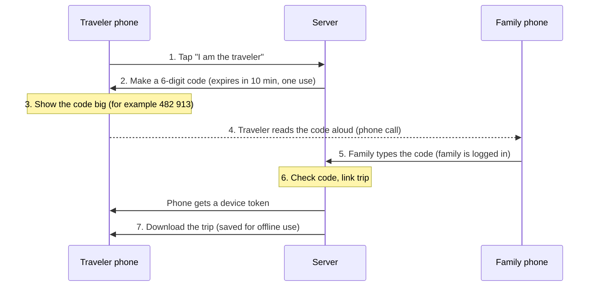
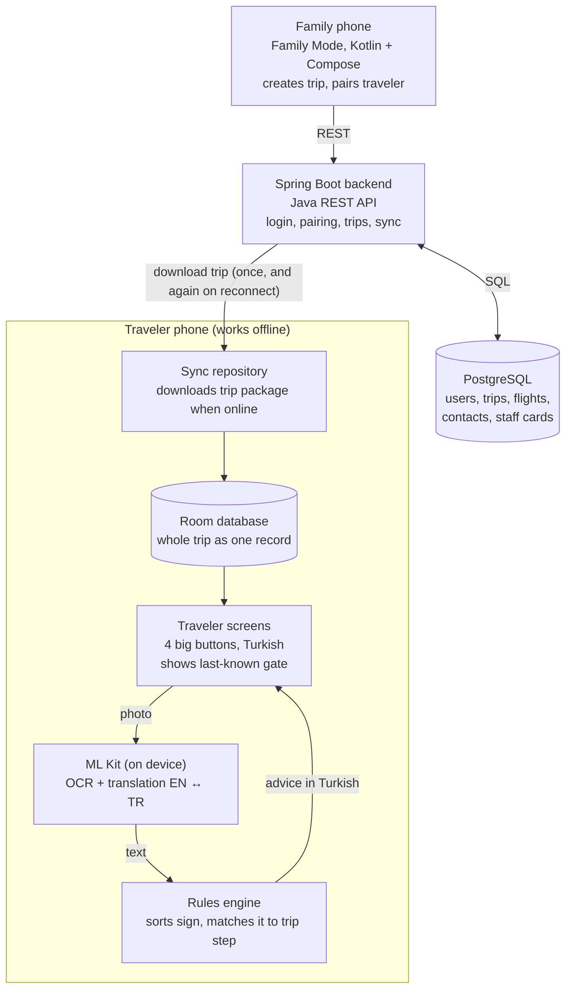

# Offline Safety Companion — Project Report (CS 152)

Oct 16, 2026

## Overview

This project is a 5-week Android app that helps an older person travel abroad alone, with English ↔ Turkish support and the core features working in airplane mode.

**The problem.** Older travelers who fly alone may not speak English well, may find phones hard to use, and may lose internet at the airport. Translation apps exist, but they don't know the traveler's trip, and they are not built for older users.

**The idea.** A family member (the caregiver) sets up the whole trip from their own phone. The traveler gets a very simple screen with four big buttons. Before the trip, the traveler's phone downloads everything it needs, so the app keeps working without internet.

**Design principle:** AI-enhanced, but not AI-dependent. This version uses no online AI at all.

## Scope

This project builds the minimum needed to show the core idea working offline. It includes:

- One Android app with Family Mode and Traveler Mode
- Family login (email + password)
- Remote pairing with a 6-digit code
- Trip setup: flights, contacts, staff cards
- Download the trip and save it on the phone
- Four traveler buttons that work offline
- Read a Sign: OCR + translation + keyword rules
- English ↔ Turkish, with correct Turkish letters
- Sync updates when internet comes back

## Users and modes

One Android app serves both users. The mode is picked once at first launch, and then the phone stays in that mode.

|  | Family Mode | Traveler Mode |
| --- | --- | --- |
| Who | Caregiver (good with technology) | Older traveler (may not read English) |
| Login | Email + password | No login; the phone is paired once |
| Main tasks | Create the trip, add flights, contacts and staff cards, pair the traveler's phone | Use four big buttons during the trip |
| Needs internet? | Yes, to save and send trip data | Only once, to download the trip |
| Language | English | Turkish |

**Mode lock.** After pairing, the traveler's phone always opens straight to the four buttons. There is no visible mode switch on the main screen. To leave Traveler Mode (for example, to reset the phone), the family must enter a PIN. This keeps the traveler from getting lost in the wrong screen.

**Why one app, not a separate web app?** One codebase is less work in 5 weeks, and it matches the original proposal.

## Pairing (remote)

The traveler's phone shows a code and the family types it in, so pairing works even when the family is in the U.S. and the traveler is in Turkey.

This works like logging in to a streaming app on a TV. The traveler types nothing; they only read six numbers aloud on a normal call. The person who is good with technology does the hard part.

Before pairing, the traveler must install the app. The family can send a Play Store link, guide them on a video call, or ask a local helper. For the demo, the app is installed on the emulator directly.

## Architecture and technology

The family phone and the server need internet; the traveler phone needs it only to download the trip.

Everything inside the traveler phone box runs with no network. The traveler's screens read only from the local Room database, never from the server.

| Part | Technology |
| --- | --- |
| Android app (both modes) | Kotlin + Jetpack Compose |
| Backend | Java + Spring Boot (REST API, JSON) |
| Server database | PostgreSQL |
| Phone database | Room (SQLite), the whole trip saved as one JSON record |
| Reading signs | ML Kit Text Recognition (Latin script) |
| Translation | ML Kit Translation, English ↔ Turkish |
| Screen changes | Simple state switch, no navigation library |
| Camera | One photo at a time, no live video |

## Traveler features

The traveler's home screen has four big buttons (at least 72dp tall), with labels in Turkish. All four work with no internet.

| Button (Turkish label shown) | What it does | Data it uses |
| --- | --- | --- |
| What Should I Do Now? | Shows the current step, like "Your next flight is TK2108 to Ankara. Go to Gate 112." | Saved flights + phone clock |
| Read a Sign | Takes one photo of a sign and explains it in Turkish, using the trip | ML Kit models + saved trip |
| Talk to Airport Staff | Shows a ready-made card in English and Turkish, with the flight and gate filled in | Saved staff cards |
| I Need Help | Shows emergency contacts and a big help card for staff | Saved contacts |

**Which step am I on?** The app compares the phone's clock with the flight times. A flight becomes "active" from 6 hours before departure until it lands. This tells the app whether the traveler is before a flight, in a connection, or at the final stop.

**Offline behavior.** Gates and flight times can change, but the phone can't learn about changes without internet. So when offline, the app always shows "Last known info as of [time]" next to the gate. When internet comes back, the app downloads the newest trip and updates the screen.

## Read a Sign and translation

Signs are read fully on the phone with pretrained Google ML Kit models, so no internet and no model training is needed.

1. **Photo.** The traveler takes one picture (no live video).
2. **OCR.** ML Kit Text Recognition (Latin script) reads the words, for example "International Transfers".
3. **Translation.** ML Kit Translation turns the English text into Turkish.
4. **Rules.** Simple keyword rules sort the sign into a group: transfer, gate, baggage, or unknown.
5. **Trip context.** The rules check the current trip step. Example: a "Baggage Claim" sign while the traveler still has a connecting flight gives a warning: "Dikkat! Bağlantı uçuşunuz var. Bagaj alanına gitmeyin."
6. **Fallback.** If the text is unclear, the app shows the staff help card instead of guessing.

**Translation both ways.** The app supports English → Turkish (signs, and short replies typed by staff) and Turkish → English (short notes from the traveler or family). Both language models are downloaded during setup, while online.

**Turkish letters.** All Turkish text uses the correct letters (ç, ğ, ı, İ, ö, ş, ü). Keyword rules must handle these letters correctly, for example by using Turkish-aware lowercase and not splitting words on non-English letters.

**Safety.** Important messages (staff cards, help cards, warnings) are written ahead of time. They are never created only by machine learning.

## Security

This version adds light security that protects the trip data and the pairing step.

| Protection | Why it's needed |
| --- | --- |
| Family login with email + password | Only the caregiver can create or change a trip |
| Random 6-digit pairing code (Java `SecureRandom`) | Codes can't be predicted |
| Code expires after 10 minutes and works only once | An old or leaked code is useless |
| Device token given to the traveler's phone after pairing | The traveler never needs a password |
| Server checks that each token reads only its own trip | One traveler can't see another's trip |
| Only needed data is stored (no passport or ID numbers) | Less harm if data leaks |

Some traveler data, like staff cards, is meant to be shown to strangers. So the biggest real risks are on the server and in the pairing step, not on the phone screen.

## Testing and demo

The main demo proves one thing: after one download, the traveler's app keeps working in airplane mode.

| Test | How | Pass when |
| --- | --- | --- |
| Logic unit tests | Plain Kotlin tests for trip-step logic and sign rules | Right step and right sign group for each case |
| Button size test | Compose UI test on the home screen | All four buttons are at least 72dp tall |
| Cold start offline | Turn on airplane mode, force-stop the app, open it again | Home screen loads fast, gate shows "Last known info", no crash |
| Sign reading offline | In airplane mode, photograph a test sign like "Transfers → Gates B1–B20" | Turkish guidance appears with no network use |
| Pairing | Traveler phone shows a code; family types it in | Trip downloads to the traveler phone |
| Sync after reconnect | Family changes gate G101 → B14, then traveler goes back online | Traveler sees B14 and a new update time |
| User test | Two older adults use the emulator for four tasks | Record task success, mistakes, time, and comments |

The user test tasks are: find the next flight, show a help card, open emergency contacts, and read a test sign.

## Risks

The biggest risk is time: 5 weeks is short, so every extra feature waits until the core demo works.

| Risk | Plan if it happens |
| --- | --- |
| Not enough time | Cut in this order: user test with older adults → Turkish → English translation → sync after reconnect |
| OCR reads signs badly | Use clear test signs; fall back to the staff card |
| Turkish keyword rules miss signs | Match English text first; Turkish words are a bonus |
| ML Kit model not downloaded | Download models during pairing and show a check mark when ready |
| Phone clock or time zone wrong | All flight times stored in UTC; show local time only on screen |
