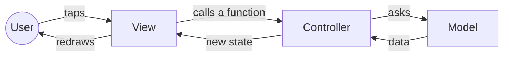
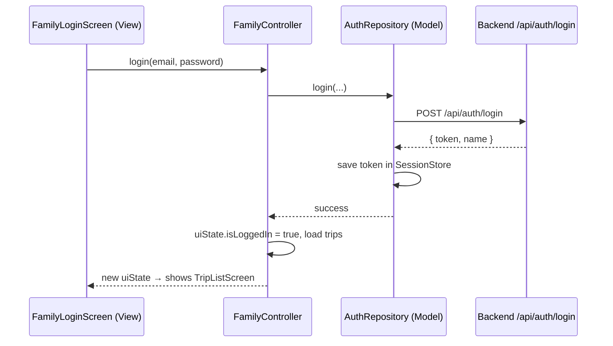
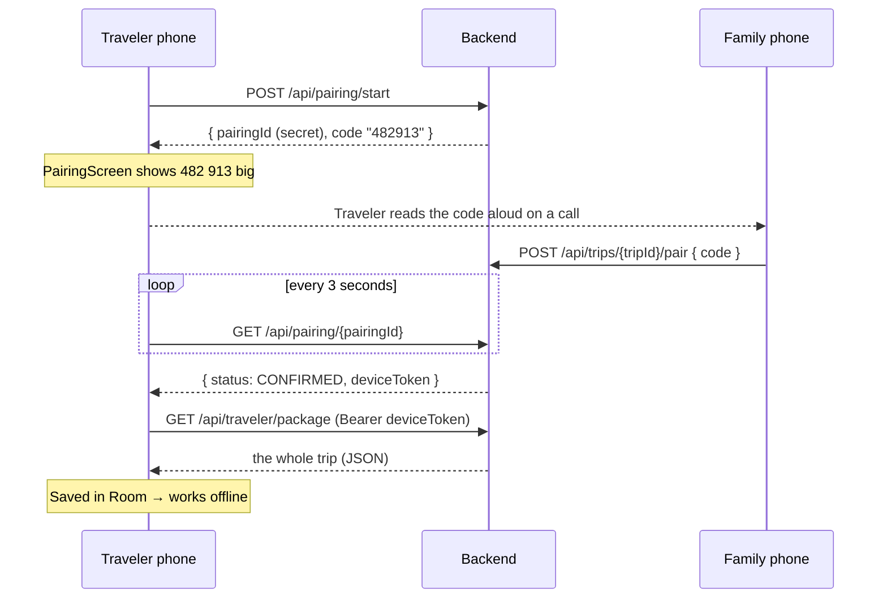
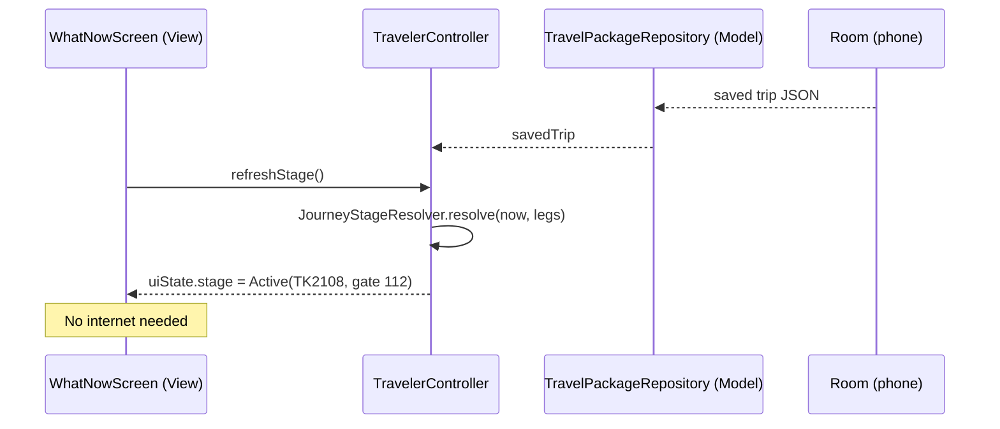

# Architecture: Model–View–Controller (MVC)

This project uses **MVC** on both the backend and the Android app. Each part of the code has one job:

| Layer | Job | Simple rule |
|---|---|---|
| **Model** | The data and the rules: database, server calls, trip logic | Knows nothing about screens |
| **View** | What the user sees | Shows data, sends user actions to the Controller |
| **Controller** | The middle: takes a user action, asks the Model, gives the result to the View | No drawing, no SQL |



---

## Backend (Spring Boot) — `backend/src/main/java/com/cs152/safetycompanion/`

| Folder | MVC layer | What's inside |
|---|---|---|
| `model/` | Model | Database tables as Java classes: `Family`, `Trip`, `JourneyLeg`, `EmergencyContact`, `StaffCard`, `PairingSession` |
| `repository/` | Model | Read/write the database (Spring Data JPA) |
| `service/` | Model (business rules) | `AuthService`, `TripService`, `PairingService` |
| `view/` | View | The JSON shapes the API sends and receives (`TripViews`, `AuthViews`, `PairingViews`) + `TripMapper` |
| `controller/` | Controller | REST endpoints (`AuthController`, `TripController`, `PairingController`, `TravelerController`) |
| `config/` | — | `DemoDataSeeder` (demo family + demo trip) |

A request always goes: **Controller → Service → Repository → database**, and the answer comes back as a **View** (JSON).

## Android app — `android/app/src/main/java/com/cs152/safetycompanion/`

| Folder | MVC layer | What's inside |
|---|---|---|
| `model/` | Model | `TravelPackage.kt` (the trip data) |
| `model/remote/` | Model | Talking to the backend (Retrofit): `ApiService`, `ApiModels` |
| `model/local/` | Model | Phone storage: Room database (`TripDocument`), `SessionStore` |
| `model/repository/` | Model | One door to the data for each feature |
| `model/logic/` | Model | Pure logic: `JourneyStageResolver`, `SignRules`, `SignReader`, `StaffCardText` |
| `controller/` | Controller | `AppController`, `FamilyController`, `TravelerController` |
| `view/` | View | Jetpack Compose screens: `family/`, `traveler/`, shared `components/` |

**Note:** on Android, the Controller classes are built on Android's `ViewModel` class. That's Android's standard tool for this job: it keeps the state alive when the screen rotates. They still play the **Controller** role:

- The **View** calls a controller function, for example `controller.startPairing()`.
- The **Controller** asks the Model and updates its `uiState`.
- The **View** watches `uiState` and redraws by itself.

`AppContainer.kt` creates the Model objects once and gives them to the controllers.

---

## Flow 1: Family signs in



## Flow 2: Pairing the traveler's phone (no login for the traveler)



## Flow 3: Traveler taps "What should I do now?" (offline)



**Offline rule:** traveler screens read **only** from Room (`TravelPackageRepository.savedTrip`), never from the server directly. The server is only used by `sync()` to refresh the saved copy.

---

## Who owns what

Each file has **one owner**. To change someone else's file, ask them first (or open a small PR they review).

| Owner | Backend | Android |
|---|---|---|
| **Family side** | Everything in `backend/` | `controller/FamilyController.kt`, `view/family/*`, `model/repository/AuthRepository.kt`, `FamilyTripRepository.kt`, `res/values/strings_family.xml` |
| **Traveler side** | — | `controller/TravelerController.kt`, `view/traveler/*`, `model/local/*`, `model/logic/*`, `model/repository/PairingRepository.kt`, `TravelPackageRepository.kt`, `res/values/strings_traveler.xml`, `app/build.gradle.kts` |

**Shared files — change only after you both agree:**

| File | Why it's shared |
|---|---|
| `backend/.../view/TripViews.java` + `android/.../model/TravelPackage.kt` | The trip JSON contract. Must always match |
| `android/.../model/remote/ApiService.kt` + `ApiModels.kt` + `docs/api.md` | The API contract |
| `android/.../view/AppRoot.kt`, `AppContainer.kt`, `view/components/Common.kt` | Used by both sides |

## TODOs to start with

| Side | File | TODO |
|---|---|---|
| Family | `view/family/TripEditorScreen.kt` | Build the trip form, then call `controller.saveTrip(...)` |
| Traveler | `model/logic/SignReader.kt` | ML Kit text recognition + English → Turkish translation |
| Traveler | `model/logic/SignRules.kt` | Transfer / gate / baggage rules + unit tests |
| Traveler | `controller/AppController.kt` | Ask for the family PIN before leaving Traveler Mode |

---

## How to run

### 1. Database (PostgreSQL, Mac)

```bash
brew install postgresql@16
brew services start postgresql@16
createdb safety_companion
```

### 2. Backend

```bash
cd backend
DB_USER=$(whoami) DB_PASSWORD= ./mvnw spring-boot:run
```

- Needs **Java 17** or newer (`java -version`).
- The first run downloads Maven and libraries (a few minutes).
- It creates the tables and a demo account: **demo@cs152.dev / demo1234** with the demo trip SFO → IST → ESB.
- Tests: `./mvnw test`

### 3. Android app

1. Open the **`android/`** folder (not the repo root) in Android Studio.
2. Wait for Gradle sync to finish.
3. Start an emulator and click **Run**.

The app reaches the backend at `http://10.0.2.2:8080/`, which is "your computer" from inside the emulator. Tests: `./gradlew test`.

### 4. Try the whole flow

- **Family:** on one emulator, pick "I am the family", then sign in with the demo account.
- **Traveler:** on a second emulator, pick "Yolcuyum" to see the 6-digit code.
- Family taps **Pair traveler's phone** and types the code. The traveler phone downloads the trip.
- Turn on **airplane mode** on the traveler emulator. The 4 buttons still work.

Only one emulator? Use the Family steps with `curl` instead (see `docs/api.md`).
